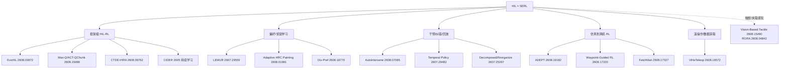

# 专题 · HIL × SERL：真机样本高效强化学习樞纽

> 本页是「**人在回路（HIL）× 样本高效强化学习（SERL）**」领域的樞纽/索引，承接本项目数据×训练主线，把抓取的新论文组织进体系。
> 主线命题：**真机强化学习正从"数据饥渴的实验室演示"走向"人在回路、十几分钟收敛、可持续积累的工程范式"——样本效率本身正成为核心竞争维度。**

---

## 0 · 主线主张

SERL（样本高效强化学习）范式已跑通"**人在回路 + 稀疏奖励 + 真机在线**"的最小闭环（典型：`HIL-SERL` 几分钟到几十分钟收敛单任务）。今天的扩展回答三个问题：

1. **还能多省？** —— 从"小时级"压到"分钟级"（Max-Q 30 分钟 vs HIL-SERL 5 小时）。
2. **还能多稳？** —— 奖励漂移、分布外、灾难性遗忘如何被工程化抑制（EvoHIL / CIDER）。
3. **还能多持久？** —— 从单任务到持续积累、从人逼真机到干预回调的闭环（AutoIntervene / CIDER）。

---

## 1 · 五条支线（横向对照）

| 支线 | 代表 | 核心机制 | 解决什么 | 硬伤 |
|---|---|---|---|---|
| **框架级 HIL-RL** | EvoHIL(2608.03872)、Max-Q(2608.15088)、CTDE+HRA(2608.09762)、CIDER | 自进化奖励+流匹配动作 / MC Q-chunk+max-Q / 集中训练分散执行+混合奖励架构 / 冻结教师+蒸馏 | 单任务收敛速度、场景漂移、多智能体非平稳 | 奖励质量仍是天花板 |
| **偏好/奖励学习** | LEMUR(2607.29559)、Adaptive HRC(2608.01981)、Div-Pref(2608.18770) | 多目标偏好奖励 / 偏好优化+CMP / 多偏好课程 | 无显式奖励函数、多目标权衡 | 偏好数据标注成本 |
| **干预/纠错/回放** | AutoIntervene(2608.07065)、Temporal Policy(2607.29482)、Decompose&Reorganize(2607.25397) | 支持记忆选择转移 / 历史初始化 / 原语+视觉运动策略 | 部署期分布漂移、长程、可组合规划 | 干预门槛与可迁移性 |
| **仿真到真机 RL** | ADEPT(2608.19182)、Waypoint-Guided RL(2608.17320)、FetchMan(2608.17027) | 预训练+稳定后训练配方 / 航点引导 / 仿真经验 | sim2real、复杂本体、探索难题 | 仿真-真机 gap |
| **遥操作/数据获取** | ViHaTeleop(2608.16572)、Pose-Aware Gloves(2607.22964) | 视觉+触觉力反馈遥操作 / 位姿伪影建模 | 高质量数据采集、力感知 | 采集成本 |

---

## 2 · 五篇支柱论文深度提炼（Insight）

### ① EvoHIL — 自进化奖励 + 流匹配动作（2608.03872）
- **核心**：把 HIL-RL 部署期三大失效耦合起来修——① 静态视觉奖励模型对场景变化失效 → `SER` 用"人确认的正样本 + 临时弱负样本"自进化成功分类器；② 独立采样动作导致时间上不连贯 → `AFS` 用流匹配生成时域连贯动作块；③ 视觉策略对表观漂移敏感 → 保留感知的离线微调，回放重打光数据并锚定 actor-critic。
- **为什么重要**：是少有的把"**奖励、动作生成、视觉域**"三者一起放进 staged HIL 流程的**统一框架**，Answer 了奖励模型不在线更新的痛点。

### ② Max-Q 选择性模仿 / ACT-QChunk-MCBC（2608.15088）
- **核心**：两个组件——① `MC Q-chunk` 把动作块级价值回归到 replay 的蒙特卡洛回报，给干预轨迹直接 credit，而非被当前策略 TD 稀释；② `max-Q 选择性模仿`在每状态取"当前策略动作 vs 缓冲样本"中 Q 更高者做赢者全取模仿。
- **为什么重要**：**真机 20 条演示 + 30 分钟 HIL 训练 99% 成功率，而 HIL-SERL 约 5 小时**——把"快"推到新量级，且自动在"学干预"与"自主提升"间切换，不引入阈值超参。

### ③ Efficient Real-World Online RL — CTDE + Hybrid Reward Architecture（2608.09762）
- **核心**：集中训练、分散执行，多个 actor 共享一个集中多头 critic；critic 拆成"任务头 + 抓取头"，对应稀疏任务奖励与基于势的抓取奖励；把离散夹爪策略的分类动作分布显式计入目标和对象。
- **为什么重要**：处理了**多智能体并发训练的非平稳性**，把域随机化范围扩大 5–25 倍仍保持样本效率，成功率从 60%→80%(网球)/60%→90%(香蕉)/25%→95%(块重排)。

### ④ AutoIntervene — 校准干预（2608.07065）
- **核心**：在线部署中在"动作块策略"与"操作员"间**选择性转移控制**；用成功执行构建的"视觉-动作支持记忆"，按"相位局部支持/全局支持"分别控制"策略→操作员"与"操作员→策略"的切换；切换阈值由留出专家演示的评估分数经验分位数校准，免手动调阈值。
- **为什么重要**：把**人从"全程带飞"降为"按需接管"**，且保留的成功 rollout 干预段能提供纠错监督用于后续策略更新——是 HIL 从"训练期"走向"部署期闭环"的关键拼图。

### ⑤ ADEPT — 预训练 + 稳定后训练（2608.19182）
- **核心**：在通用物体重排任务上预训练灵巧策略，再以此为先验做下游后训练；用「行为克隆蒸馏 + critic 预热 + 保守 on-policy 更新」的稳定配方防止原生 RL 微调破坏预训练能力；引入关节空间 Geometric Fabric 安全发挥完整运动学灵巧度。
- **为什么重要**：少见的"**大规模 RL 预训练 → sim2real 灵巧**"配方，23 DoF Allegro 与 29 DoF Flexiv-Sharpa 两本体零样本迁移，能从挑战性初始状态以类人速度解长程任务——把 SERL 的"样本效率"从单任务升维到"跨任务复用"。

### ⑥（支线补充）CIDER — 持续交互蒸馏（2606 序列）
- **核心**：学新任务前把历史策略冻结为教师，交错"任务学习 + 基于蒸馏的保持"，并用梯度路由分离"学新"与"保旧"的梯度。
- **为什么重要**：六个真实任务序列用单一共享 actor，交互蒸馏保持旧任务高成功率且每个新任务 10–20 分钟收敛，基线必忘至少一个旧任务——把 SERL 推向**持续学习/灾难性遗忘**这一真机落地的必答题。

---

## 3 · 跨论文洞见

- **"快"的本质是估值方式**：Max-Q 用 MC Q-chunk 直接 credit 干预，CTDE+HRA 用多头 critic 解耦稀疏奖励与抓取势能——都在**改进"信用分配/价值估值"**而非堆算力。样本效率的下一个杠杆在 critic，不在 actor。
- **奖励是共同天花板**：EvoHIL 自进化奖励、LEMUR/Div-Pref 学偏好、Adaptive HRC 偏好优化，三条线都在攻"**没有可靠奖励函数怎么办**"。HIL 的价值正从"给监督"转向"给偏好/给确认/给干预"，即**奖励工程的再分配**。
- **人在回路的三阶段成熟**：训练期（HIL-RL）→ 部署期（AutoIntervene）→ 持续期（CIDER）。SERL 不再是单次 job，而是**持续自我补强的系统**。
- **触觉/力是 HIL 的感知底座**：ViHaTeleop、Pose-Aware Gloves、Vision-Based Tactile、RORA 同批出现，说明 HIL 要"真"地干预，需要**力觉与位觉的闭环数据**，与项目既有"接触力支线"（MimicTouch/DanfeiEGO）同源。

---

## 4 · 关系与下一步

- **承接主线**：呼应既有 `数据×训练` 与 `EGO&UMI roadmap`，HIL/SERL 提供"**低成本在线纠错数据 + 秒级策略更新**"，与离线大数据互补（离线学分布、在线学边界）。
- **下一步建议**：
  1. 把 **EvoHIL / Max-Q / CIDER** 三篇纳入待精读优先，深读其实验证伪性（EvoHIL 的 SER 标签漂移；CIDE 的梯度路由实现细节）。
  2. 与既有 `专题-机器人具身评估` 打通：AutoIntervene 的"支持记忆切换阈值校准"可视为**部署期过程级评估**的一种。
  3. 若走真实机落地线，把 **ViHaTeleop(视觉触觉遥操作)** 与既有 `UMI/EGO` 数据引擎串起来，评估"力反馈遥操作数据"是否值得接入。
- **已入库待精读**：见 `_待精读.md`（2026-09-07 追加的 hil/serl 批次，均为 `[ ]`）。
