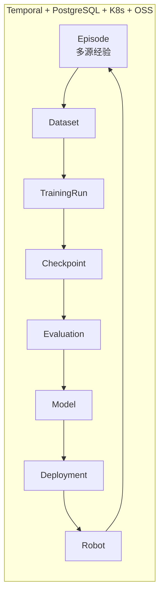

# 专题 · 具身智能 Infra 全套（架构师视角）

> 目标不是"逐知识点"，而是**按架构闭环**建立体系。每一套架构都回答同一组问题：
> **它解决闭环里的哪一段 / 核心对象是什么 / 输入输出是什么 / 如何并入统一底座。**
> 统一底座 = 你已熟悉的 **Temporal + PostgreSQL + Kubernetes + OSS**。



---

## 0 · 闭环总览：Infra 覆盖 01–06 六段

| # | 闭环段 | 主架构 | 你的栈里对应 |
|---|--------|--------|--------------|
| 01 | 数据（多源经验→Dataset） | ROS2 / rosbag / 数据引擎 | OSS 存原始+rosbag+domain data |
| 02 | 训练与模型（TrainingRun→Checkpoint） | PyTorch DDP/FSDP + Slurm | Slurm 训练分区 + K8s 批调度 |
| 03 | 评测与安全（Evaluation） | Isaac Lab / MuJoCo / ManiSkill | 评测 Job→K8s/Slurm + metrics 落库 |
| 04 | 部署运行（Model→Deployment→Robot） | ONNX / TensorRT + ROS2 node | 部署物→OSS 版本 + K8s 推理服务 |
| 05 | 真实机器人（Robot） | ROS2 系统架构 | robot fleet 注册 + 遥操数据回流 |
| 06 | 反馈回流（Episode→Dataset 再训练） | MLflow lineage + 持续学习 | Temporal 编排 post-training + 持续收集 |

**贯穿所有段的"唯一骨架"是 lineage（血缘）**：从 Episode 到 Robot 再到下一轮 Episode，每个对象都被注册、可追溯。这正是 MLflow / 企业 MLOps 的核心洞见，也是你要自建 Control Plane 的原因。

---

## 一、PyTorch Distributed / FSDP 训练架构（P0）— 段 02

> 解决闭环里的「训练与模型」这一段：把 Dataset 变成可复现的 Checkpoint。

```text
Dataset → DataLoader → Training Process → DDP/FSDP → NCCL → GPU0..N → Checkpoint
```

### 要搞懂的五件事
| 概念 | 机制 | 输入→输出 |
|------|------|-----------|
| **DDP** | 每卡一份**全模型副本**，数据并行切 batch；反向时梯度 `all-reduce` 求均值 | batch partition → 一致梯度 |
| **FSDP** | **ZeRO-3**：把参数/梯度/optimizer state **分片**到各卡；前向 `all-gather`、反向 `reduce-scatter`；通信与计算重叠 | 分片权重 → 整卡可算的层权重 |
| **NCCL** | 三原语：`all-reduce`(DDP)、`all-gather`+`reduce-scatter`(FSDP)；ring/tree 拓扑 | 跨卡张量 → 汇总/分发张量 |
| **Checkpoint** | 区分 **full**（整状态 dict：model/optimizer/RNG/sampler/step）与 **sharded**（`torch.distributed.checkpoint`，按分片存、可 reshard）；**async checkpoint** 不阻塞训练 | 训练状态 → 可恢复的快照 |
| **DataLoader** | 多 worker 预取、shuffle、**bucketing/按长度分桶**（加快 src/tgt）、pin memory；防止 GPU 空转（**I/O 饥饿**） | 数据集 → 稳态 GPU 供给 batch |

### 业界实践
- PyTorch 2.x：`torch.compile` + FSDP 训 10B+ 机器人基础模型；`torch.distributed` 的 `elastic` 做容错重启。
- HF `Accelerate` / `DeepSpeed` 是 FSDP/ZeRO 之上的薄封装；云上常见 `srun`/`K8s`（Volcano、Kueue）调度多机多卡 Job。
- **关键认知**：Checkpoint 是"训练侧"对象，不等于部署物（见第五套）。

### 并入统一底座
- Slurm/K8s 调度 TrainingRun Job；Checkpoint（full/sharded + 配置）写 **OSS 对象存储**（版本化、共享多卡恢复）。
- metadata（TrainingRun、硬件拓扑、超参、Checkpoint 分片清单）→ **PostgreSQL**。
- **Temporal** 管"训练→产 Checkpoint→触发评测"的工作流与失败重试。

---

## 二、MLflow Model Lifecycle / Registry（P0）— 段 02→03→04

> 解决「模型是怎么产生、演进、上线的」。**吸收的不是 UI，而是生命周期与 lineage。**

```text
Code+Dataset+Config → Experiment → Run → Checkpoint → Metrics
        → Registered Model → Model Version → Stage(Staging/Production)
```

### 核心对象
| 对象 | 是什么 | 输入→输出 |
|------|--------|-----------|
| Experiment | 一组相关 Run 的集合（一次研究/一个算法线） | 题目 → Runs |
| Run | 一次具体训练执行（含 Code+Data+Config 指纹） | 参数 → 日志/Metrics/Artifacts |
| Registered Model | 一个有名字、可版本化的模型实体（**不是文件**） | 一批 Run → Model 实体 |
| Model Version | 该模型的某个确定版本 + Stage（None/Staging/Production/Archived） | 一个 checkpoint → 版本记录 |
| Artifacts | 实际二进制（权重、tokenizer、normalizer、config） | 产物 → 对象存储 |

### 最关键的一句
> **AI 世界里，模型不是一个文件，而是一条 lineage（血缘）。**

### 企业版升级 —— 你的统一 Infra 底座核心数据模型
```
Episode → Dataset → TrainingRun → Checkpoint → Evaluation → Model → Deployment → Robot → Episode
```
这个环不是概念，而是 Control Plane 里 **PostgreSQL 的实体关系**（见第七套）。

### 并入统一底座
- MLflow Tracking Store 可落 **PostgreSQL**；Artifact/Model registry 落 **OSS**。
- 业界对标：**Weights & Biases**（追踪）、**Hugging Face Hub**（注册+分发生态）、**DVC**（数据版本）。企业自建常用 MLflow 做 tracking+registry，配自己的对象存储与元数据库。

---

## 三、ROS2 系统架构（P0）— 段 05 真实机器人

> 理解**真实世界的数据怎么产生、模型怎么接进去、动作怎么送出去**。目标不是写机器人应用，而是把"数据引擎"和"机器人侧"连起来。

```text
Camera/Joint/Force Node ─→ Topic ─→ Observation
                                        ↓
                                   Policy Node
                                        ↓
                                      Action
                                        ↓
                                   Controller → Robot
```

### ROS2 概念速查
| 概念 | 作用 | 类比 |
|------|------|------|
| Node | 一个功能单元（感知/策略/控制） | 微服务 |
| Topic / Pub-Sub | 异步**多对多**数据流（Observation、Action） | 消息总线 |
| Service | 请求-响应（同步 RPC） | REST |
| Action | 长时任务：goal + feedback + result | 任务 API |
| **DDS** | 底层传输/发现中间件 | 传输层 |
| **QoS** | 可靠性/时延权衡（best-effort vs reliable） | 消息语义 |
| Parameter | 节点运行参数（相机内参、动作限幅） | 配置 |
| **TF** | 坐标变换树（base→ee→camera） | 上下文 |
| **rosbag** | 录制/回放话题数据 | 数据采集/审计 |

### 最新论文/业界关联
- **SmoothRL (2608.29768)**：线上 RL 在异步执行下的**实时平滑执行**——策略推理与机器人控制解耦，直接是"Policy Node"落地问题。
- **GHOST (2608.29080)**：多机器人 VR 遥操作+数据回流，体现"机器人→数据引擎"这一段。
- 业界：`micro-ROS`（嵌入式）、`NVIDIA Isaac ROS`（GPU 加速感知+推理 node）。

### 并入统一底座
- 机器人侧：policy 以 ROS2 Node 运行，消费 obs topic、产 action topic → Controller。
- 数据侧：rosbag/Episodes 上传 **OSS** 进 Dataset；机器人/车队注册在 **PostgreSQL**（Robot 实体）。
- 部署：Model Registry 发布的**部署物**经 **Temporal** 编排推到 Robot 的 Policy Node。

---

## 四、Slurm GPU Cluster（P0）— 段 02 底层算力

> 补上"算力"这一层。理解 Job/Node/Partition/调度，再和你熟知的 K8s 对比。

```text
User → sbatch/srun → Slurm Controller → Queue/Scheduler → Compute Node{GPU0..3}
```

### 核心对象
| 对象 | 说明 |
|------|------|
| Job | 一次算力请求（sbatch 脚本 + 资源限制） |
| Node / Partition | 计算节点 / 节点分组（按机型、用途） |
| Queue / Priority | 排队与优先级（抢占比、backfill 填缝） |
| Reservation | 预留（某团队固定时段拿独占节点） |
| GPU allocation | 按卡分配（--gpus），`gres` 广义资源 |
| Gang scheduling | 多节点 Job 同步起停（避免单点阻塞） |

### Slurm vs Kubernetes
```
Slurm        → 训练 / HPC / Batch（长任务、独占、裸机性能）
Kubernetes   → 服务 / Pipeline / 在线系统（弹性、容器、滚动、可观测）
```
- **业界现状**：模型训练集群多用 **Slurm**（大厂 HPC farm），在线推理/服务用 **K8s**；K8s 批调度插件 **Volcano / Kueue** 在补"训练负载"的空缺。
- **你的栈**：K8s 已是底座；把 Slurm 作为"训练 Partition"，或直接用 K8s+Volcano 统一，避免两套调度心智。

---

## 五、ONNX / TensorRT 部署（P1）— 段 04 部署运行

> 搞懂模型怎么从"训练世界"进入"机器人世界"。

```text
Checkpoint → Export → ONNX → TensorRT Engine build → Edge GPU Runtime → ROS2 Node
```

### 要建立的认知（最重要）
> **Checkpoint ≠ Deployment Artifact（部署物）。**

部署物不止权重，还含：`weights + normalizer + camera config + action schema + runtime version + calibration`。

### 关键概念
| 概念 | 说明 |
|------|------|
| Export | 从训练框架导出中间表示（ONNX），固化计算图 |
| **ONNX** | 可移植中间格式（模型可互换层） |
| **TensorRT** | NVIDIA 推理引擎：**图优化 + 算子融合 + 精度选择** |
| **FP16/INT8** | 量化压缩；INT8 需 **calibration（校准集）** 定阈值 |
| dynamic shape | 输入维度可变（batch、序列长度）时引擎需显式指定 |
| latency / VRAM | 部署的硬约束（机器人要求低时延、小显存） |
| engine build | 把 ONNX 编译成目标 GPU 专用引擎（耗时，需离线构建） |

### 业界实践
- 推理服务：**Triton Inference Server**（多模型/动态 batch）、**ONNX Runtime**、**vLLM**（LLM 场景）。
- 边缘：**NVIDIA Jetson ORIN** + TensorRT，运行机器人 on-robot 策略；DLA/Tensor Core 加速。

### 并入统一底座
- 每个"部署物"是 Model Registry 里的一个**版本**（weights+normalizer+config+engine+calibration），存 **OSS**。
- 推理服务进 **K8s**；机器人侧以 ROS2 Node 加载 engine。

---

## 六、Evaluation 架构（P1）— 段 03 评测与安全

> 不要把评测当脚本，要把它变成**平台**。

```text
Model Candidate → Evaluation Orchestrator
      ├─ Offline Benchmark
      ├─ Simulation (MuJoCo / Isaac Lab / ManiSkill / RoboTwin)
      ├─ Real Robot
      └─ Safety Test
      → Metrics → Baseline Comparison → Release Gate
```

### 核心要点
- Simulator 只是 **backend**（可换）；真正要设计的是 **Orchestrator + Metrics + Release Gate**。
- 评测要回答"**能不能发**"，所以 `Release Gate` 是 Infra 而非锦上添花（对应你已有 `专题-机器人具身评估` 的"过程级稠密审计"洞见）。
- 评测反馈回链：Evaluation → 触发再训练（post-training），构成 06 回流。

### 最新论文关联
- **R2S-Eval (2609.03276)**：用 VLM 做 **real-to-sim 校准**评估机器人策略——把"真机评估"也纳入了可复现的 sim 流程。
- **CFAMs (2609.04552)**：部署后持续域适应评估（post-deployment），补"上线后还要测"的空缺。

### 并入统一底座
- 评测 Job → **K8s/Slurm**；评测 Metrics + baseline 对比 → **PostgreSQL**（供 dashboard/Release Gate 读）。
- simulator 镜像（Isaac Lab / MuJoCo）作为容器镜像版本管理；每一次 Evaluation 关联到一个 Model Version 与一个 Dataset/World。

---

## 七、自建 Control Plane（最重要）— 把 01–06 全部串起来

> 前面六套都是"可买/可借鉴的框架"。**统一底座是你自己的 Control Plane**——这不是外部框架，而是把六套连成一个 lineage 闭环的编排与元数据层。

```text
                 Control Plane
     PostgreSQL(Metadata/Registry) + Temporal + API/RBAC/UI
                         │
 ┌────────┬──────────┬────┴─────┬──────────┬─────────┐
Data     Training   Eval       Model     Robot
Platform  Platform   Platform  Registry  Fleet
```

### 核心对象（= PostgreSQL 实体）
| 实体 | 关键字段 | 归属段 |
|------|----------|--------|
| **Episode** | robot_id, source, obs/act 索引, timestamp | 01/05 |
| **Dataset** | version, blend 配方(EGO/UMI/sim/real), splits | 01 |
| **TrainingRun** | code+data+config 指纹, cluster, duration, resource | 02 |
| **Checkpoint** | step, metric, shard 清单, oss path | 02 |
| **Evaluation** | orchestrator, backend, metrics, result | 03 |
| **Model** | lineage↔Run, tags | 02→03 |
| **Deployment** | artifact version, target robot, stage | 04 |
| **Robot** | fleet id, embodiment, sensor config, 状态 | 05 |

### 核心 lineage（闭合成环）
```
Dataset → TrainingRun → Checkpoint → Evaluation → Model → Deployment → Robot → Episode → Dataset
```

### 技术栈职责划分（你已熟悉的四件套）
- **Temporal**：编排一切长时/重试/跨系统流程——"训练→评测→发布→部署→回流再训练"全生命周期工作流。
- **PostgreSQL**：唯一事实源（元数据/注册中心/lineage 关系/评测 metrics/机器人车队）。
- **Kubernetes**：在线服务（推理、评测 orchestrator、Control Plane API/UI）的弹性载体。
- **OSS**：一切大对象——原始 Episode/rosbag、Dataset、Checkpoint、Model Artifact/Deployment、评测产物。

---

## 8 · 七天落地路线（你自己的学习→成图）

| 天 | 内容 | 产出 |
|----|------|------|
| D1 | ROS2 架构 + PyTorch DDP/FSDP | 机器人端 + 训练端两头 |
| D2 | Slurm 架构 + NCCL | 补算力 |
| D3 | MLflow lineage | 补 Dataset→Run→Model 生命周期 |
| D4 | TensorRT/ONNX | 训练世界→机器人世界 |
| D5 | Isaac Lab / MuJoCo 评测 | 补评测 |
| D6–7 | **不看图，自己画闭环** | 多源经验→Data→Training→Eval→Release→Robot→回流→Post-training |

**自测标准**：不查资料画出下面闭环，并讲清每条箭头的**数据结构与责任边界**，第一阶学习即完成：

```
多源经验 → Data → Training → Eval → Model Release → Robot → Data Return → Post-training
```

并把 **PyTorch / Slurm / MLflow / TensorRT / ROS2 / Temporal / PostgreSQL / Kubernetes / OSS** 逐项放回正确位置（见第 0 节表格）。

---

## 9 · 与既有知识库的连接
- **数据侧**：`数据×训练-研究纲领`（EGO/UMI/仿真/真机四层栈）是 01 数据的"造法"，本篇补充"如何进 Infra 被训、被评、被部署"。
- **评估侧**：复用 `专题-机器人具身评估` 的"过程级稠密审计"思想，落成 Evaluation Platform 的 Release Gate。
- **HIL/SERL**：`专题-HIL×SERL` 的在线/持续学习，正是 06 "回流再训练"与 Robot→Episode 闭环的算法侧体现（CIDER 持续学习、Max-Q 在线 RL）。
- **待深读（Infra 向，新增）**：SmoothRL(2608.29768)、VLA-Precision(2609.04355)、R2S-Eval(2609.03276)、CFAMs(2609.04552)、TacPAC(2609.05266)、StructRL(2608.15139)。
