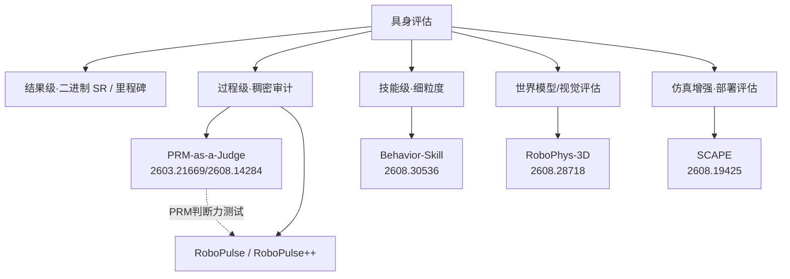

# 专题 · 机器人具身评估：枢纽与线路图谱

> 本页是「机器人具身评估」领域的**枢纽/索引**，汇总不同评估支线，并给出线路图谱。  
> 主线命题：**具身评估正从"二进制成功与否"走向"可诊断、可预测、可验证的过程级/技能级稠密评估"。**

---

## 0 · 主线主张

二进制 success rate 把丰富执行过程压成一个比特，丢三样东西：**走了多远(progress)、怎么走的(efficiency/quality)、在哪断(stability/diagnosis)**。  
具身评估的下一个方向 = **把"评估"本身变成可诊断、可预测、可验证的工程**，而非一个偶然成败的比特。

---

## 1 · 四大支线（横向对照）

| 支线 | 代表 | 评估单位 | 解决什么 | 硬伤 |
|---|---|---|---|---|
| **过程级稠密** | PRM-as-a-Judge(2603.21669/2608.14284) | 轨迹→进度曲线 | 过程质量/恢复/诊断 | 依赖 PRM 本身质量 |
| **技能级细粒度** | Behavior-Skill(2608.30536) | 可执行技能 | 长程中间失败不可见 | 接触类技能仍是瓶颈 |
| **世界模型评估** | RoboPhys-3D(2608.28718) | 3D 重建一致性 | 生成 rollout 保真与可执行性 | 无统一 3D 接地协议的历史问题 |
| **WAM 方法(对照)** | DreamZero(2602.15922) | 视频+动作联合 | 零样本策略、跨本体 post-training | 跨本体需梯度 |
| **ICL-任务规格(对照)** | **Zero-WAM(2608.26103)** | 人类视频 in-context | **真 ICL：零参数跨任务** | 需 paired human-robot 数据 |
| **仿真增强部署** | SCAPE(2608.19425) | 场景条件性能区间 | sim2real 偏置 + 安全部署 | 需配对 sim-real 样本 |

---

## 2 · 支线详情

### 2.1 过程级稠密审计 —— PRM-as-a-Judge（本线核心，详见子文档）
- **命题**：把 rollout 变进度曲线，用 PRM 当裁判审计"走了多远/怎么走/在哪断"。
- **OPD 指标体系**：Outcome(MP/M25/SR) · Process(PPL/CRA/STR/DRR/FNS) · Diagnosis(失败定位)。
- **两公理**：macro-consistency（进度可加）+ micro-resolution（细粒度敏感）。
- **GitHub 开源**：`YuyangLiu2003/PRM-as-a-Judge`（Apache2.0，可跑 demo）。
- **RoboPulse/Pulse++**：专测 PRM 判断力的诊断基准（HF 开源）。
- **被 Orca 采用**做 action-generation 评估。

### 2.2 技能级细粒度 —— Behavior-Skill（2608.30536）
- **命题**：长程任务整体成功依赖多个子技能；现有 benchmark 只看整任务 rollout，中间失败不可见。
- **做法**：围绕**可执行子技能**重构学习与评估 —— 235,492 技能实例 / 10,000 demo / 50 任务 / 34 语义技能类。
- 每个技能实例配：skill 指令 + 对齐的 obs-action 段 + 可恢复中间态 + 技能成功条件（独立评估）。
- **发现**：失败**高度不均匀**分布在技能间，**接触丰富技能是持久瓶颈**（pi0.5/GR00T 实测）。
- **对你的意义**：直接证实"过程监督/技能级监督比整任务成功率更能定位瓶颈" —— 且**接触类技能正是你 R4/R6 关注的**。

### 2.3 世界模型评估 —— RoboPhys-3D（2608.28718）
- **命题**：视频世界模型当数据引擎/规划器/仿真器，但缺乏统一 3D 接地协议，无法确认生成 rollout 是否保真 3D 场景状态、能否转成可执行动作。
- **做法**：RoboTwin2.0 上建 50 任务 / 5,000 ep / 25,000 多视角 GT；生成与 GT 走**同一条 3D 重建管线**，区分重建误差 vs 生成误差。
- **50 指标 → 18 子维 → 4 层**：像素保真 / 3D 几何一致性 / 状态级理解 / 任务级完整度。
- **RoboPhyscore（任务对齐紧凑分）**：Cosmos 3 最高 0.633；**state/execution-grounded 指标暴露感知/VLM 判据漏掉的失败**；与人类评估强相关(Pearson r=0.976)。
- **对你的意义**：世界模型评估（L5）与"评估可执行性"绑定 —— 裁判不能只看像素，要看能否落地成动作。

### 2.4 仿真增强部署评估 —— SCAPE（2608.19425）
- **命题**：真机评估忠实但贵，仿真可扩展但 sim2real 有偏；现有仿真增强只报 population 平均，掩盖场景差异、无法指导安全部署。
- **做法**：**场景条件化**仿真增强评估 —— 先用有限配对 sim-real 样本**校正 sim 标签的 sim2real 偏置**，再训练预测模型 + **conformal prediction** 校准不确定性。
- **结果**：driving/quadruped 场景级误差降 4.9–34.7%；物理 Unitree Go2 验证；样本效率↑、预测区间更窄、OOD 泛化更好。
- **对你的意义**：评估不止"打分"，还要"**能不能安全部署/在哪个场景部署**"—— 与你的企业数据集落地视角相关。

---

## 3 · 横切 Insight

1. **四支线共享同一转向**：从"一个比特的成功"→"**可定位失败、可预测性能、可验证能力**的多层评估"。
2. **过程级与技能级是"粒度"两极**：PRM-as-a-Judge 连续进度(微分辨) ∥ Behavior-Skill 离散技能(语义可解释)——**连续 vs 离散，两条互补路径**。
3. **裁判本身也要被评估**（RoboPulse 测 PRM；RoboPhys-3D 怀疑 VLM/perceptual 判据）——评估的可信度是元问题，正是 RewardBench 在 LLM 侧的对应物。
4. **接触类普遍是瓶颈**（Behavior-Skill 接触技能 · PRM 接触过渡 · ManuFacet 力同步）——**再次印证你的"接触精密"是数据与评估的共同堵点**。
5. **与"数据×训练"互证**：更好的评估→更好的数据质量门→更好的 PRM/模型；评估与数据互为因果。

---

## 4 · 子文档索引（飞书主文档下）
- 专题 · 机器人具身评估（过程级稠密审计线）—— PRM-as-a-Judge 精读
- 专题 · 机器人具身评估：枢纽与线路图谱（本页）
- （可扩展）Behavior-Skill / RoboPhys-3D / SCAPE 各自精读子文档

## 5 · 关联
数据×训练研究纲领 · R6接触/过程监督 · 具身世界模型(L5) · RewardBench/LLM-judge 横向对比 · 企业数据集版图
